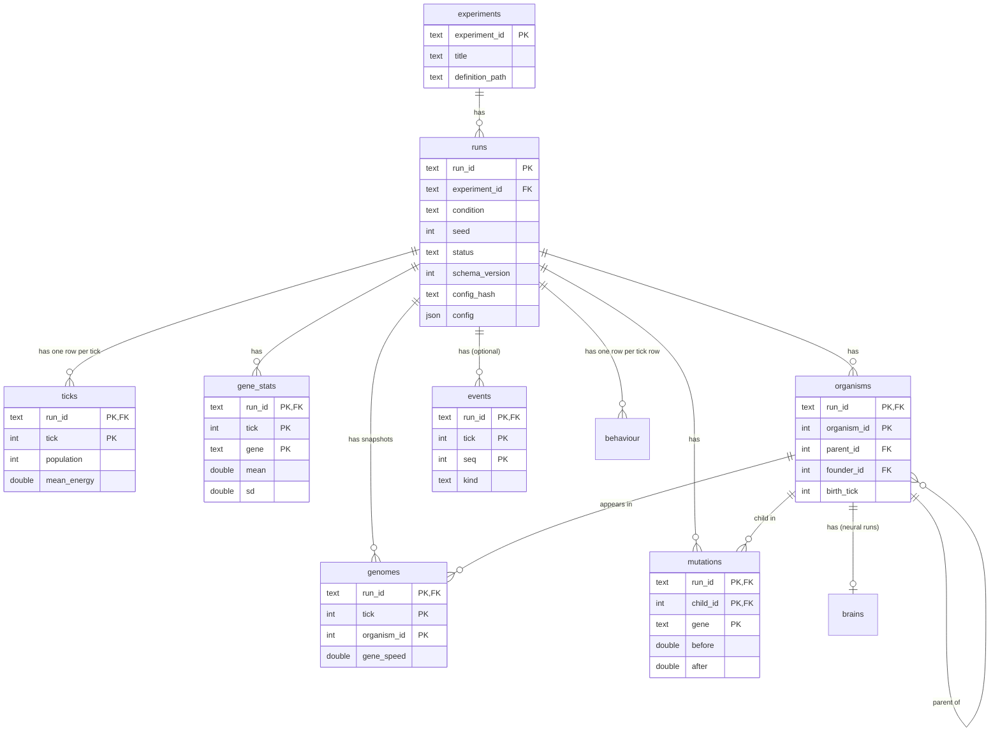

# Database schema (Milestone 3)

Status: **approved 2026-10-19**; run-folder schema version 3 implemented in 3.1, version 5 (worlds with predators) in 6.4. Column-level detail is in the [data dictionary](data-dictionary.md).

## Why a database at all

Each run already writes CSV files. That works for one run, but questions across many runs ("mean settled sense range per condition, E003, completed runs only") currently need a custom Python script each time. A database lets you ask them in one SQL query. E002 and E003 alone are 1.9 GB of CSV; the same data as Parquet is about 10× smaller (measured: 16.2 MB → 1.5 MB for one run).

## Key terms

| Term | Meaning here |
|---|---|
| **Table** | A set of rows that all have the same columns, like one CSV file. |
| **Schema** | The plan of the database: which tables exist, their columns and types, and how tables connect. |
| **Primary key** | The column(s) whose values identify exactly one row. No two rows may share them. |
| **Composite key** | A primary key made of several columns, e.g. (`run_id`, `organism_id`). |
| **Foreign key** | A column that refers to another table's primary key, e.g. `ticks.run_id` → `runs.run_id`. This is what a JOIN follows. |
| **View** | A saved query that behaves like a table. It stores no data; it re-reads its sources each time. |
| **Parquet** | A compressed file format that stores a table column by column, so scans that read a few columns are fast. |
| **DuckDB** | An analytical database engine that runs inside Python (no server) and can query Parquet files directly with SQL. |
| **ETL** | Extract, transform, load: the pipeline that reads run folders, checks and converts them, and writes Parquet. |

## Architecture: files are the truth, the database is a lens

```text
 genesis run / experiment runner
            │ writes (unchanged from Milestone 2)
            ▼
 data/runs/... and data/experiments/<EXP>/<condition>-s<seed>/      run.json + CSVs
            │ ETL: validate, convert, never edit the source
            ▼
 data/lake/<table>/<run_id>.parquet                                  one file per run per table
            │ DuckDB views read the files directly
            ▼
 data/genesis.duckdb                                                 views only; rebuildable
```

- **Parquet files are the source of truth.** They can be copied, exported and read by pandas, DuckDB, R or Spark without Genesis Lab.
- **The DuckDB file holds only views** (plus the small `experiments` table). Deleting it loses nothing: `genesis db rebuild` recreates it.
- **One Parquet file per run per table** means adding a run never rewrites existing files, and re-importing one run replaces exactly one file.
- **Run folders are never modified by the ETL.** If the ETL has a bug, the raw data is still intact.

## Tables



| Table | One row per | Primary key | Source |
|---|---|---|---|
| `experiments` | experiment | `experiment_id` | experiment definition files |
| `runs` | simulation run | `run_id` | `run.json` |
| `ticks` | run × tick (or sampled tick) | (`run_id`, `tick`) | `ticks.csv` |
| `gene_stats` | run × tick × gene | (`run_id`, `tick`, `gene`) | `gene_stats.csv` |
| `genomes` | run × snapshot tick × organism | (`run_id`, `tick`, `organism_id`) | `genomes.csv` |
| `organisms` | run × organism ever alive | (`run_id`, `organism_id`) | `organisms.csv` |
| `mutations` | gene change at a birth | (`run_id`, `child_id`, `gene`) | `mutations.csv` |
| `events` | birth, death or meal (optional) | (`run_id`, `tick`, `seq`) | `events.csv` (new in 3.1) |
| `behaviour` | run × recorded tick | (`run_id`, `tick`) | `behaviour.csv` (new in 4.5) |
| `brains` | run × organism with a brain | (`run_id`, `organism_id`) | `brains.csv` (new in 4.5) |

### Why every key starts with `run_id`

Organism 17 exists in every run, and tick 500 exists in every run. On their own, these numbers identify nothing. Only (`run_id`, `organism_id`) is unique. Forgetting the `run_id` in a JOIN is the most common way to get silently wrong answers here, such as matching organism 17 from one run with organism 17 from another. Every example query will show the correct form.

### Lineage: a table that points at itself

`organisms.parent_id` refers to another row of `organisms` **in the same run**. Following it repeatedly (child → parent → grandparent → founder) needs a **recursive query** (`WITH RECURSIVE`), which SQL supports. `founder_id` is stored directly as a shortcut, so "which founding family?" needs no recursion.

### Joining time series with lineage (an acceptance criterion)

Example: *how large was the population when each organism was born?*

```sql
SELECT o.run_id, o.organism_id, o.birth_tick, t.population AS population_at_birth
FROM organisms AS o
JOIN ticks AS t
  ON t.run_id = o.run_id          -- same run (never forget this)
 AND t.tick   = o.birth_tick;     -- same moment
```

If ticks are sampled (3.1), not every birth tick has a row; such queries use the nearest earlier sampled tick (an "as-of" join, which DuckDB supports).

## Views (saved queries), implemented in 3.3

| View | Purpose |
|---|---|
| `completed_runs` | `runs WHERE status = 'completed'`. Analyses start here, so failed runs are excluded by default (acceptance criterion). |
| `run_params` | Commonly filtered config values as plain columns: controller, food regrowth, mutation on/rate/size, initial count, trade-off costs; `has_brains`, brain mutation rate and size (4.5). |
| `settled_gene_means(first_tick, last_tick)` | Table macro: per run and gene, the mean over a tick window (the E002/E003 measurement), with `rows_in_window` and `rows_with_population` so incomplete windows can be spotted. |
| `experiments` | Built from `docs/experiments/E*.md` on connect, including the commit that first added each definition. |
| `lineage_sizes` | Per run and founder: descendants ever born, alive at the end. |

## Old run folders: schema versions

Run folders were written by different code over time. Each gets a `schema_version` (stored in `run.json` from 3.1; inferred for older runs):

| Version | Written by | Files | Notes |
|---|---|---|---|
| 1 | Milestone 1 (E001) | `run.json`, `ticks.csv`, `organisms.csv` | No genes, no `mutations` column in ticks |
| 2 | Milestone 2 (E002, E003) | + `gene_stats.csv`, `genomes.csv`, `mutations.csv` | `condition` only in the folder name |
| 3 | Milestone 3 | + optional `events.csv`; `condition`, `config_hash`, sampling settings in `run.json` | |
| 4 | Milestone 4 | + `behaviour.csv`, `brains.csv` | Every earlier file byte-identical to version 3 for the same config and seed |
| 5 | Milestone 6 (6.4) | + `predator_ticks.csv`, `predators.csv`, `predator_brains.csv`, `strikes.csv`, only in worlds with predators; `run.json` gains `final_predators`, `predators_ever` | Worlds without predators write exactly the version 4 files, byte-identical; `brains` gains 18 nullable predator-weight columns (D-060) |

The ETL fills columns a version lacks with NULL ("unknown"), never with 0 or a guess. For versions 1–2, `condition` is taken from the folder name (`S_plenty-s2000` → `S_plenty`), and the data dictionary records that it was derived.

## Missing values: NULL, not NaN

The CSVs write "no value" (e.g. mean energy of an empty population) as `nan`. In the database these become **NULL**: SQL's aggregate functions skip NULLs (`AVG` over three values and one NULL averages the three), whereas a single NaN would make the whole average NaN.

## What the database does not do

- **It doesn't enforce keys or constraints.** Parquet files and views can't. The ETL checks uniqueness of every primary key, that every foreign key points at an existing row, and value ranges, and refuses to load a run that fails. Tests cover these checks.
- **It doesn't replace run folders.** They remain the raw record; the lake is derived from them.
